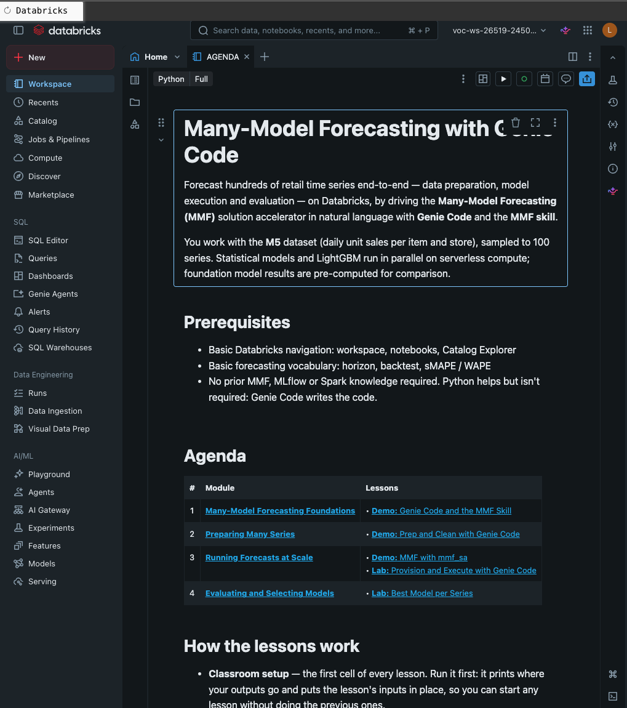

# MMF Workshop — Many-Model Forecasting with Genie Code

Hands-on workshop on [Many-Model Forecasting (MMF)](https://github.com/databricks-industry-solutions/many-model-forecasting) using Databricks Genie Code and the MMF skill on the M5 dataset.

## Overview

Participants use **Genie Code** (Databricks' AI coding agent) with the **MMF skill** to forecast ~100–1,000 retail time series end-to-end: data preparation, profiling, model execution, evaluation, and deployment. The skill guides each step via natural language prompts with built-in checks.

**Dataset:** [M5 Forecasting Competition](https://www.kaggle.com/c/m5-forecasting-accuracy) — Walmart daily sales, sampled to 100 or 1,000 series.

**Models:**
- **Local statistical:** SeasonalNaive, AutoETS, AutoTheta, CrostonOptimized, TSB
- **Global ML:** LightGBM (MLForecast)
- **Foundation:** Chronos-Bolt-Small (pre-computed reference results)



*The course landing notebook (`AGENDA`) in a Vocareum-provisioned workspace, with links to each module and lesson.*

## Repository structure

```
├── README.md
├── assets/                   # Images used in this README
├── SPECS/
│   ├── SPEC.md              # Workshop specification
│   ├── VOCAREUM.md           # Vocareum environment research
│   └── NOTES.md              # Working notes and test results
├── setup/                    # Admin-only — never shipped to learners
│   ├── workspace_setup.py    # Once per workspace: data, skill bundle staging, grants
│   ├── user_setup.py         # Optional: admin-side MMF skill install (lessons self-install)
│   ├── 00_data_load.py       # Load M5 data into Unity Catalog (called by workspace_setup)
│   ├── 01_precompute_foundation.py  # Pre-compute foundation model results (CPU)
│   └── VERSIONS.md           # Pinned upstream versions
├── vocareum/                 # Vocareum course packaging — see vocareum/README.md
│   ├── courseware/mmf-workshop.cfg  # Course config (content, setup hooks, admin cluster)
│   └── scripts/python/mmf_lab_end.py  # Lab-end reaper for learner jobs/clusters/experiments
└── labs/Source/en_us/        # Course layout — see SPECS/RESTRUCTURE.md
    ├── notebooks/            # Learner course (packaged as mmf-workshop-labs.zip)
    │   ├── AGENDA.py                 # Landing notebook: modules and lesson links
    │   ├── Version Info.py           # Version + build date (filled by the build), dataset attributions
    │   ├── Includes/
    │   │   ├── _common.py            # Read/write locations + helpers (run by every Classroom-Setup)
    │   │   ├── _checks.py            # "Check your work" report
    │   │   ├── _backtest_explorer.py # HTML/JS widget for lecture 3.1
    │   │   ├── _metric_explorer.py   # HTML/JS widget for appendix 4.2
    │   │   ├── Classroom-Setup-x.y.py  # Puts each lesson's inputs in place (enter any lesson cold)
    │   │   └── Print-Dataset-Copyrights.py
    │   ├── M01 - Many-Model Forecasting Foundations/
    │   │   └── 1.2 Demo - Genie Code and the MMF Skill.py
    │   ├── M02 - Preparing Many Series/
    │   │   └── 2.2 Demo - Prep and Clean with Genie Code.py
    │   ├── M03 - Running Forecasts at Scale/
    │   │   ├── 3.1 Lecture - Backtesting and Forecast Stability.py  # Interactive backtest explorer (JS)
    │   │   ├── 3.2 Demo - MMF with mmf_sa.py              # Also the reference solution
    │   │   ├── 3.3 Lab - Provision and Execute with Genie Code.py
    │   │   └── 3.4 Appendix - Forecasting with Exogenous Variables.py  # SNAP / events / prices as regressors
    │   └── M04 - Evaluating and Selecting Models/
    │       ├── 4.1 Lab - Best Model per Series.py
    │       └── 4.2 Appendix - Choosing a Forecast Metric.py   # Interactive metric explorer (JS)
    ├── instructor/
    │   └── Foundation Models on GPU.py   # Instructor-led only; not packaged
    └── voc/docs/README.md    # Learner instructions (Vocareum side pane)
```

## Where outputs go

Every lesson's Classroom setup runs `Includes/_common`, which prints the shared data location and the learner's output location:

| Environment | Reads from | Writes to |
|-------------|-----------|-----------|
| Vocareum | `mmf.m5` | The per-user location from the lab platform's `ops.meta` table when present; otherwise `{managed_catalog}.mmf`, the per-user catalog Vocareum creates (e.g. `vocuser12345_vocareum_com`) and drops at lab end |
| Instructor-led workshop | `mmf.m5` | `mmf.{user}` — schema derived from the email |

Override with the `user_catalog` / `user_schema` widgets (job parameters). Learner notebooks never create catalogs.

## Lesson independence

Every lesson can be entered cold:
- **Classroom setup** (`%run ../Includes/Classroom-Setup-x.y`, first cell of each lesson) puts the lesson's inputs in place. If an earlier lesson wasn't done, it copies them from the shared data or the pre-computed reference results in `mmf.m5_reference`.
- **Short on time?** cells, in lessons where Genie Code builds something, put that lesson's output in place in seconds.
- **Check your work** (last section) prints PASS/FAIL for each expected output. Learner feedback only — the course is not graded.

## Setup (instructor / admin)

Both setup notebooks run as a workspace admin and are safe to re-run. On Vocareum they are the `workspace_setup` and `user_setup` entries of the course `.cfg`, called with `host` / `token` (and `username`). For an instructor-led workshop, run them by hand.

### 1. Workspace setup — `setup/workspace_setup.py`

Run once per workspace. It:

1. Creates `mmf.m5` and the `mmf.m5.assets` volume.
2. Stages, from the upstream repo pinned by the `mmf_ref` widget (see `setup/VERSIONS.md`), the MMF skill bundle and agent instructions in `/Volumes/mmf/m5/assets/skills/`, and an `mmf_sa` wheel plus requirements files in `/Volumes/mmf/m5/assets/wheels/`.
3. Runs `00_data_load` (raw M5 files cached in the volume) and `01_precompute_foundation`, skipping either if its tables already exist (`force_reload=true` to redo):

   | Table | Description |
   |-------|-------------|
   | `daily_train_100` | 100 sampled series (seed=7) |
   | `daily_train_1000` | 1,000 sampled series (seed=7) |
   | `m5_static_features` | Item/store metadata |
   | `reference_evaluation_output` | Chronos-Bolt-Small results on CPU (100 series × 2 backtest windows) — needed because Vocareum has no GPU. Lab 5 merges them with participant results |

4. Runs the reference solution (lesson *3.2 Demo — MMF with mmf_sa*, 100 series) into `mmf.m5_reference`, which lessons copy from when entered cold. Skipped if present.
5. Grants `learner_group` (default `account users`) read-only access to `mmf.m5` and `mmf.m5_reference`. For an instructor-led workshop set `allow_user_schemas=true`, so participants can create their `mmf.{user}` schema.

### 2. User setup — `setup/user_setup.py` (optional)

Lessons install the MMF skill for each learner on their first Classroom setup (`Includes/_skill`), so no per-user step is required. Use this notebook to install it ahead of time — e.g. for an instructor-led workshop — or to force a reinstall.

Run once per learner, with `username` set to their email (comma-separated for several). It installs the staged bundle into `/Users/{email}/.assistant/skills/`, and `assistant_instructions.md` — with its `### User Context` filled in — as `/Users/{email}/.assistant_instructions.md`.

### Packaging

See [`vocareum/README.md`](vocareum/README.md) for the Vocareum course settings, uploads and test plan.


`uv run mmf-workshop build` writes two archives to `dist/`: `mmf-workshop-labs.zip` (learner content) and `mmf-workshop-setup.zip` (admin setup, plus the course notebooks so `workspace_setup` can run the reference solution). Learners never receive the setup notebooks. Each build is stamped with a build id (`<version>+g<commit>[.dirty]`) shown in `Version Info`, printed by every Classroom setup, and recorded by `workspace_setup` in `mmf.m5.course_build` — see [vocareum/README.md](vocareum/README.md#which-build-is-deployed).

## Running the lessons

### As a participant (with Genie Code)

1. Open a lesson and run its Classroom setup cell
2. Follow the lesson's Genie Code steps
3. If stuck, run the lesson's *Short on time?* cell

### As a test (serverless jobs)

```bash
# 3.2 Demo — CPU forecast, reference solution (100 series, ~10 min)
databricks jobs submit --json '{
  "tasks": [{"task_key": "main",
    "notebook_task": {"notebook_path": "/path/to/mmf-workshop/M03 - Running Forecasts at Scale/3.2 Demo - MMF with mmf_sa",
      "base_parameters": {"catalog": "mmf", "user_schema": "u_test",
        "source_schema": "m5", "n_series": "100"}},
    "environment_key": "env"}],
  "environments": [{"environment_key": "env",
    "spec": {"client": "4", "dependencies": []}}]}'

# 4.1 Lab — Evaluate (~2 min)
databricks jobs submit --json '{
  "tasks": [{"task_key": "main",
    "notebook_task": {"notebook_path": "/path/to/mmf-workshop/M04 - Evaluating and Selecting Models/4.1 Lab - Best Model per Series",
      "base_parameters": {"catalog": "mmf", "user_schema": "u_test",
        "source_schema": "m5", "metric": "smape"}},
    "environment_key": "env"}],
  "environments": [{"environment_key": "env",
    "spec": {"client": "4", "dependencies": []}}]}'
```

## Known limitations

- **No GPU on Vocareum:** Both EC2 GPU quota and serverless GPU are unavailable. Foundation models are pre-computed on CPU and stored as reference data.
- **MMF foundation models require GPU:** `run_forecast` with `accelerator="cpu"` silently skips foundation models. The pre-compute notebook uses `chronos-forecasting` directly instead.
- **`mmf_sa` not on PyPI:** `workspace_setup` builds it from the pinned upstream commit into `/Volumes/mmf/m5/assets/wheels/`; labs install it with `%pip install -r /Volumes/mmf/m5/assets/wheels/requirements-cpu.txt`. Pins are listed in `setup/VERSIONS.md`.

## Test results (2026-10-15)

| Step | Status | Detail |
|------|--------|--------|
| Data load | PASS | 3 tables in `mmf.m5` |
| Lab 4 CPU (100 series) | PASS | 6 models, 891 eval rows each |
| Lab 5 evaluate | PASS | 99 best models selected |
| Foundation pre-compute | PASS | ChronosBoltSmall, 200 eval rows, avg SMAPE 1.54 |
